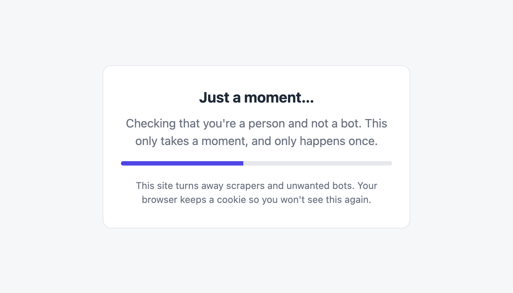
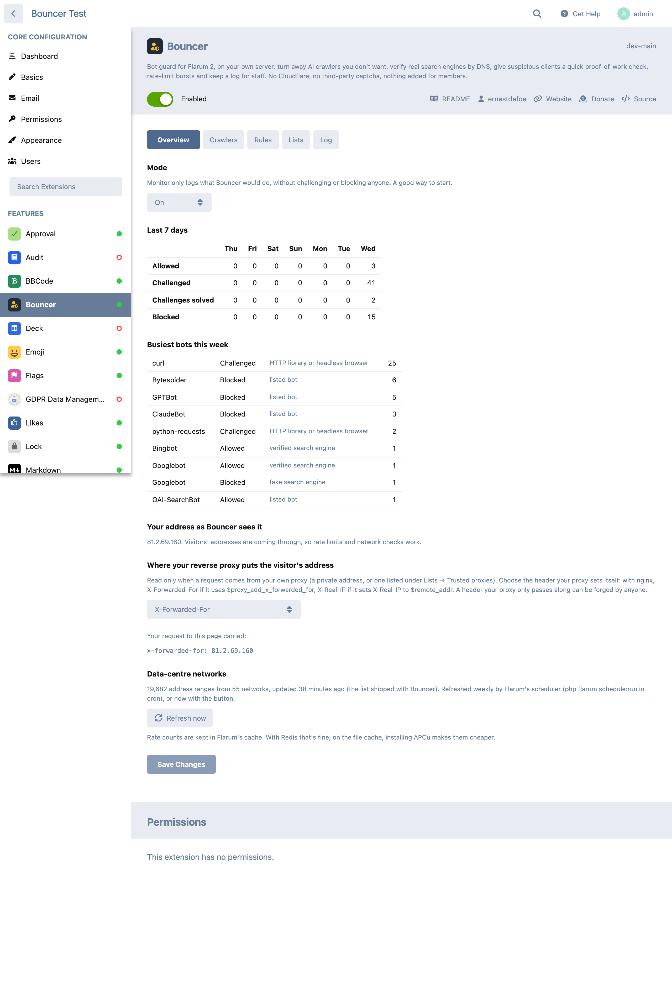
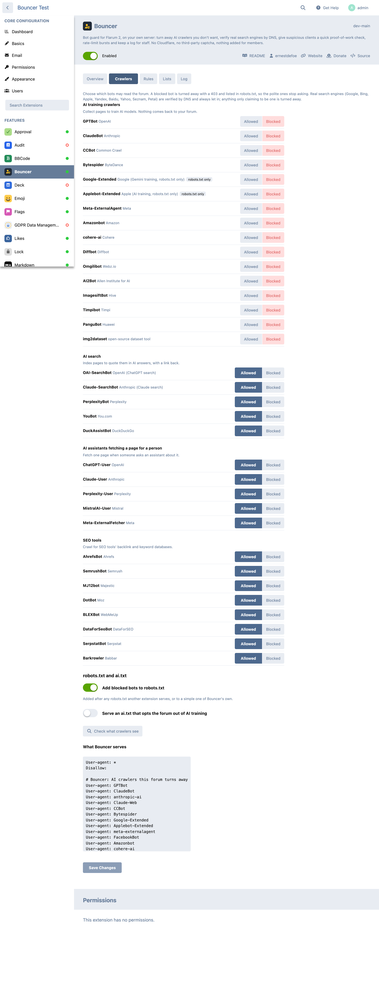
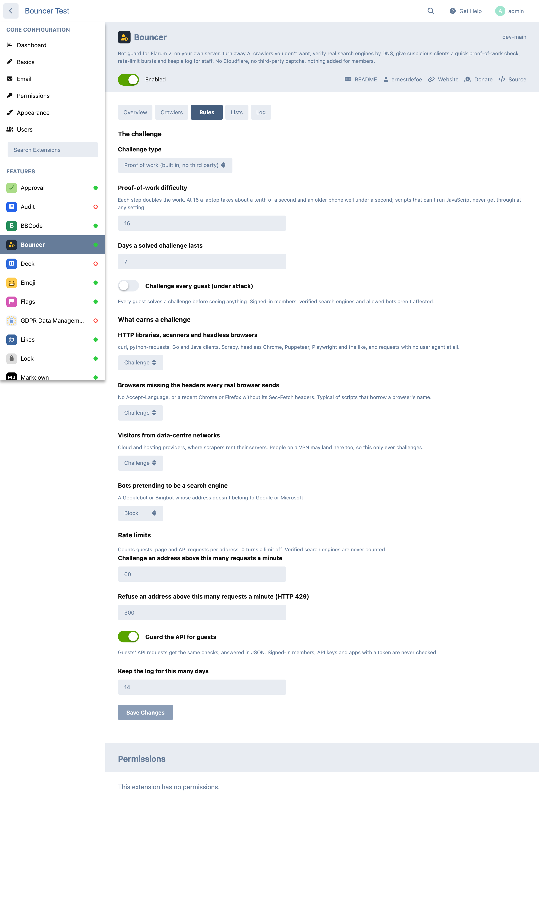
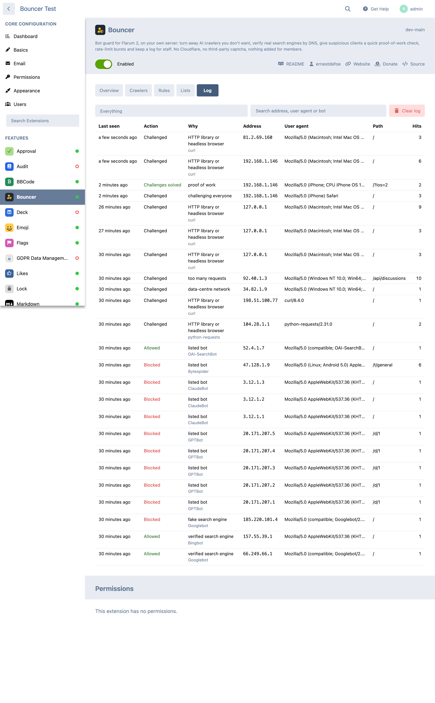
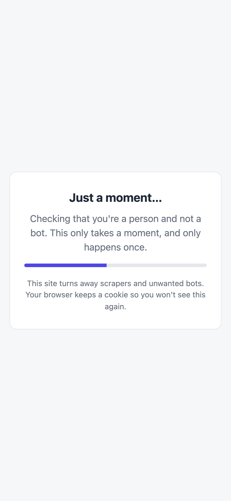

# Bouncer

A bot guard for Flarum 2 that runs on your own server. It turns away the AI
crawlers you don't want and verifies real search engines by DNS. Suspicious
clients get a quick proof-of-work check, bursts are rate limited, and staff
get a log of what happened. You don't need Cloudflare's proxy or a
third-party captcha, and members get no extra JavaScript or database work.



## Features

- **AI crawlers, one by one.** GPTBot, ClaudeBot, CCBot, Bytespider,
  Meta-ExternalAgent, Amazonbot and the other training crawlers are blocked
  by default. AI search bots (OAI-SearchBot, Claude-SearchBot,
  PerplexityBot…), assistants fetching a page for someone (ChatGPT-User,
  Claude-User…) and SEO tools are allowed by default. Switch any of them
  either way. A blocked bot gets a 403.
- **robots.txt and ai.txt.** Blocked bots are listed in `robots.txt`, so the
  polite ones stop asking. Robots-only opt-outs such as Google-Extended and
  Applebot-Extended are included. If another extension already serves a
  robots.txt, Bouncer adds its group to it. You can also serve a
  [Spawning ai.txt](https://site.spawning.ai/spawning-ai-txt) that opts the
  whole site out of training. A button checks whether your web server
  actually hands those paths to Flarum.
- **Real search engines are never challenged.** Googlebot, Bingbot,
  Applebot, Yandex, Baidu, Yahoo, Seznam and Petal are verified the way the
  engines document: the reverse DNS name must belong to the engine, and it
  must resolve back to the same address. Results are cached for a day.
  Anything that only claims to be Googlebot is turned away. That includes a
  rented Google Cloud VM, whose `googleusercontent.com` name doesn't count.
- **A challenge, not a captcha.** A suspicious guest sees a small
  self-contained page (no forum assets) whose browser works out a SHA-256
  proof of work. That takes a tenth of a second on a laptop and well under a
  second on an older phone. It then returns to the page they asked for, with
  a signed cookie so they aren't asked again for a week. Scripts that can't
  run JavaScript never get past it. If you already use a Turnstile extension
  ([flectar/flarum-turnstile](https://github.com/flectar/flarum-ext-turnstile)),
  you can show Turnstile instead, with the same keys.
- **What earns a challenge:**
  - HTTP libraries and headless browsers (curl, python-requests, Go, Java,
    Scrapy, HeadlessChrome, Puppeteer, Playwright…), and requests with no
    user agent at all;
  - "browsers" missing the headers every real browser sends (no
    Accept-Language, or a recent Chrome or Firefox without Sec-Fetch headers
    on HTTPS);
  - visitors from data-centre networks: about 55 cloud and hosting networks
    (AWS, Google Cloud, Azure, Hetzner, OVH, DigitalOcean, Alibaba,
    ByteDance…), with their prefixes from RIPEstat, refreshed weekly;
  - bursts: more than 60 requests a minute from one address (adjustable),
    with a hard limit (429) above 300;
  - everyone, when you switch on "under attack".
  Each signal can be switched off, and some can block instead.
- **Your server, your addresses.** Behind nginx, a container or a load
  balancer, Bouncer finds the visitor's real address in `X-Forwarded-For`,
  trusting only private addresses and the proxies you list. It believes
  `CF-Connecting-IP` only when the request really came through Cloudflare's
  published ranges. If every visitor looks like the proxy, the admin page
  says so, and per-address checks stand down instead of challenging
  everyone.
- **A log for staff.** Allowed bots, challenges, solved and failed answers,
  blocks and rate limits, with the address, user agent, path, reason and hit
  count. One row per address and reason every ten minutes, so a hammering
  bot writes a handful of rows. The overview shows the last seven days and
  the busiest bots. Entries are kept for 14 days (adjustable).
- **Monitor only.** Log what Bouncer would do without challenging anyone,
  to see what it catches before switching it on.
- **Allow and block lists.** Addresses and ranges, user-agent text, paths
  that are never checked (feeds, sitemaps and robots.txt by default), extra
  AS numbers to count as data centres, or ones to leave out.



## What it never touches

- **Signed-in members**, at all. No JavaScript is added to the forum for
  anyone.
- **API clients with a token** (apps, bots, a GitHub release announcer) and
  Flarum's own internal API calls.
- **The server itself.** Requests from loopback (a Docker health check
  curling `http://127.0.0.1/`, a cache warmer, cron) are never checked.
- **Anything but GET and HEAD.** Logins, posting, webhooks and payment
  callbacks go straight through.
- **Ordinary visitors' database work.** A guest who isn't suspicious costs
  one counter increment (in APCu if PHP has it, otherwise Flarum's cache)
  and no database queries.

## Install

```sh
composer require ernestdefoe/bouncer
php flarum migrate
php flarum cache:clear
```

Then enable Bouncer in the admin. To start gently, set the mode to **Monitor
only** for a day and read the log.

The data-centre list is refreshed weekly by Flarum's scheduler, so make sure
`php flarum schedule:run` runs from cron. A snapshot ships with the
extension, so it works from the first request. You can refresh by hand with
`php flarum bouncer:networks`.

### Good to know

- **robots.txt and ai.txt** have to reach Flarum. Many nginx setups answer
  `/robots.txt` from disk (`location = /robots.txt { … }`). Use **Check what
  crawlers see** on the Crawlers tab.
- **Reverse proxy:** have it append the visitor's address to
  `X-Forwarded-For` (nginx: `proxy_set_header X-Forwarded-For
  $proxy_add_x_forwarded_for;`). Don't pass a client's own header through
  unchanged.
- **Your own JSON endpoints** that other servers fetch as guests with an HTTP
  library (licence or update feeds, for example): add their paths under
  **Never check these paths**.
- With OPcache (on by default in PHP-FPM), the data-centre list costs
  nothing to load. Without it, about 3 ms on the requests that need it.

## Screenshots

| | |
|---|---|
|  |  |
|  |  |

## Support

Bug reports and questions: the
[support forum](https://ernestdefoe.online/t/bouncer) or
[GitHub issues](https://github.com/ernestdefoe/bouncer/issues).

☕ If you like the things I have built, consider
[buying me a coffee](https://buymeacoffee.com/ernestdefoe).

MIT licensed.
